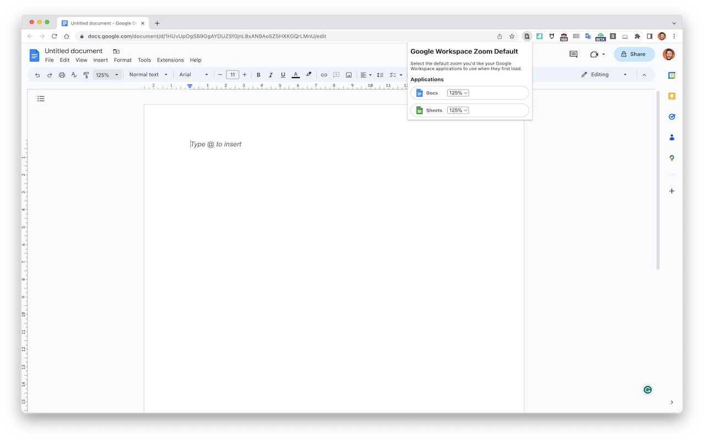
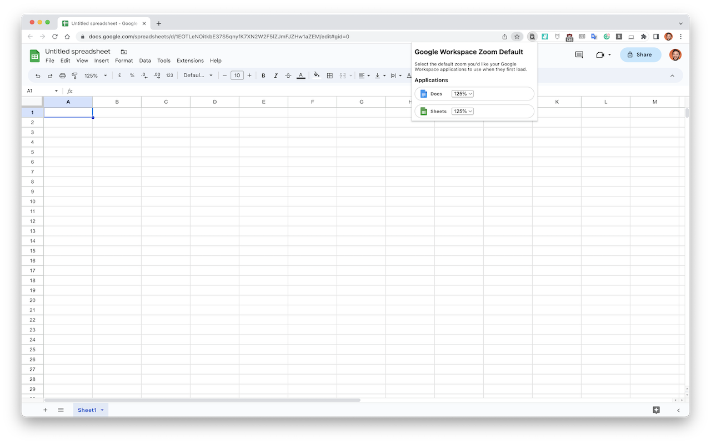
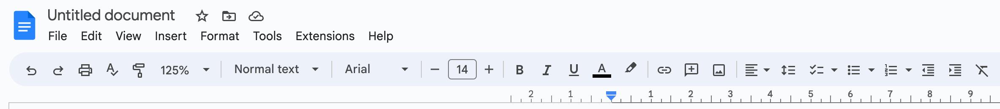
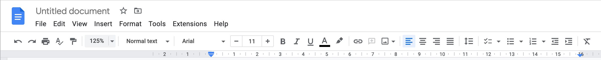

# Default zoom for Google Workspace

<small>Formerly _"Google Workspace Zoom Default"_. Stupid Edge store...</small>

[](https://buymeacoffee.com/vernacchia)

👉 I wrote a bit more about it on my blog both [when I first released it](https://words.byvernacchia.com/blog/my-first-chrome-extension/)
and [when I updated it](https://words.byvernacchia.com/blog/2023/03/introducing-google-workspace-zoom-default/). You can also see it in action on [YouTube](https://www.youtube.com/watch?v=WYmmMaQXE7Y)!

Supported Google Workspace Products:

- [x] Google Docs
- [x] Google Docs (view only permissions) - Experimental
- [x] Google Sheets
- [x] Google Sheets (view only permissions)
- [x] Google Classroom Docs + Sheets - Experimental
- [ ] Google Slides (maybe)

| Google Docs                         | Google Sheets                         |
| ----------------------------------- | ------------------------------------- |
|  |  |

## Browser Support

|                                              | Chrome Extension | Microsoft Edge Add-ons | Firefox Add-ons |
| -------------------------------------------- | ---------------- | ---------------------- | --------------- |
| Default zoom for Google Workspace            | ✅               | ✅                     | ✅              |
| Default zoom for Google Workspace (Extended) | ✅               | ✅                     | ❌              |

### Find it on Chrome Web Store

- [Default zoom for Google Workspace][chrome-webstore-default]
- [Default zoom for Google Workspace (Extended)][chrome-webstore-extended]
  - In exchange for allowing elevated permissions, this extension provides ability to set custom zoom levels (as opposed to only predefined values)

### Find it on Microsoft Edge Add-ons

- [Default zoom for Google Workspace][edge-addons-default]
- [Default zoom for Google Workspace (Extended)][edge-addons-extended]
  - In exchange for allowing elevated permissions, this extension provides ability to set custom zoom levels (as opposed to only predefined values)

### Find it on Firefox Add-ons

- [Default zoom for Google Workspace][firefox-addons-default]

:rotating_light: **NOTE:** Firefox does not support the "debugger" permission, meaning custom zoom values are not supported

## Localisation

I'm a native English speaker, but want to provide this Chrome Extension for everyone. That being said,
I've used Google Translate the values for non-English languages. I know they're probably not correct.

To automate the translation process, we use Google Cloud Translation API.

### Translate UI strings (`messages.json`)

To translate all missing strings from the English source to all other languages:

```bash
GOOGLE_APPLICATION_CREDENTIALS=./path-to-creds.json node bin/translate-messages.mjs
```

To translate or update a specific key only:

```bash
GOOGLE_APPLICATION_CREDENTIALS=./path-to-creds.json node bin/translate-messages.mjs --key="yourKeyName"
```

### Translate Store Listings

To translate the store listings:

```bash
GOOGLE_APPLICATION_CREDENTIALS=./path-to-creds.json node bin/translate-store-listing-translate.mjs --listing=base
```

If you feel like helping me out, would be much appreciated if you could submit a new issue, using the
"[Update/Add Locale Information](https://github.com/vernak2539/chrome-extension-google-doc-default-zoom/issues/new/choose)"
issue template. Or, reach out to me, and we can have a chat!

## Motivation

I'm getting old (or my monitor is has too much resolution), which makes it harder to see the small text in Google Docs.

There are two ways to increase the size:

1. Use the "Zoom" feature in the Google Doc via the menu
2. Use the browser's zoom function

I don't like using the latter due to it changing zoom across loads of webpages. So, I tried to figure out how to progress
with the former (option #1 :wink:) via a Chrome Extension.

## Actually Doing It

I ended up using [Plasmo](https://docs.plasmo.com/) to get up and running quickly. Chrome Extensions are new to me, so
this allowed me to get started pretty quickly (still figuring out the messaging aspect between content scripts, background,
and popup :grimacing:).

Ended up getting a simple prototype built in a couple hours and submitted to the Webstore :crossed_fingers: (will update
if / when approved).

It's pretty bare bones now and likely will have some quirks. This is likely due to how Google Docs:

1. Doesn't provide a JS SDK to programmatically do things in Google Docs
   - If it does, please message me or open an Issue!
2. Is quite finicky when you try to simulate events (due to the first point)

Issues are always appreciated, and I'll try to answer accordingly. Please remember that I do this in my spare time and
Chrome Extensions and Plasmo are quite new to me.

## Does it work with the Google Docs redesign?

Yes, it should work with the new design! I didn't even have to do anything. I'll continue to monitor this as we go, but
if you see any problems please submit an issue!

**New Design**



**Current/Old Design**



## Data Privacy

This Chrome Extension will never collect or transmit any personal data. It never reads or sends the text of your
documents or spreadsheets.

I do use [Sentry](https://sentry.io/welcome/) for error monitoring to diagnose and fix errors more easily. This, in turn,
makes this extension better. When an error happens, the following is sent to Sentry:

- the error message and stack trace
- the extension version and edition, the language of your browser, whether Google Docs or Google Sheets was open, and
  the version of the extension's settings format
- your browser's user agent (the browser and operating system version)
- the address of the page, with the document ID, query string and fragment removed. For example,
  `https://docs.google.com/document/d/<document ID>/edit?usp=sharing#heading=h.abc` is sent as
  `https://docs.google.com/document/[redacted]`
- the layout of the page, as element IDs and class names (no text)

The page that referred you to the document is never sent.

[chrome-webstore-default]: https://chrome.google.com/webstore/detail/google-docs-zoom-default/nflkcdlimipkgbacnfnhfecjgmojhklo
[chrome-webstore-extended]: https://chrome.google.com/webstore/detail/google-workspace-zoom-def/mdgikencgfhineaememjagpkiclbdkka
[edge-addons-default]: https://microsoftedge.microsoft.com/addons/detail/google-workspace-zoom-def/hnilnnalkgihkfnegpcbcgpgailgjbnn
[edge-addons-extended]: https://microsoftedge.microsoft.com/addons/detail/google-workspace-zoom-def/fhjmigdmbgbiodkejhmahfnaebdgnmjb
[firefox-addons-default]: https://addons.mozilla.org/en-GB/firefox/addon/google-workspace-zoom-default/
